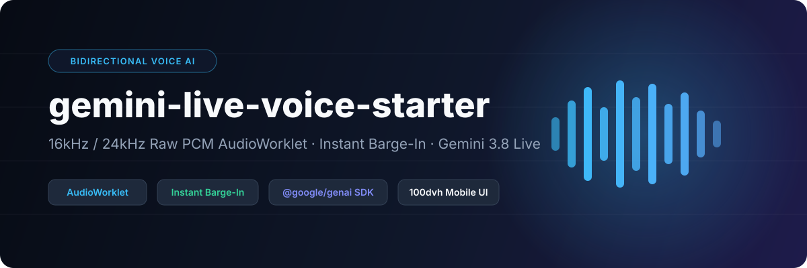
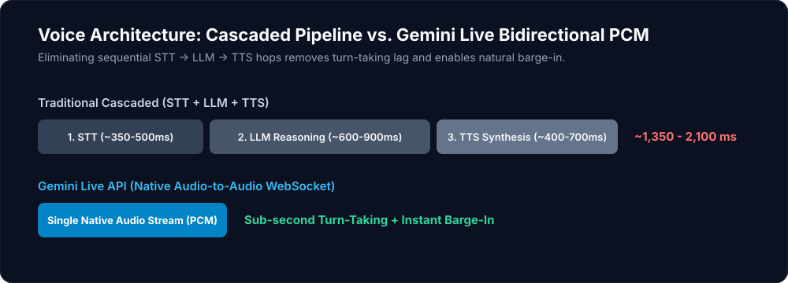
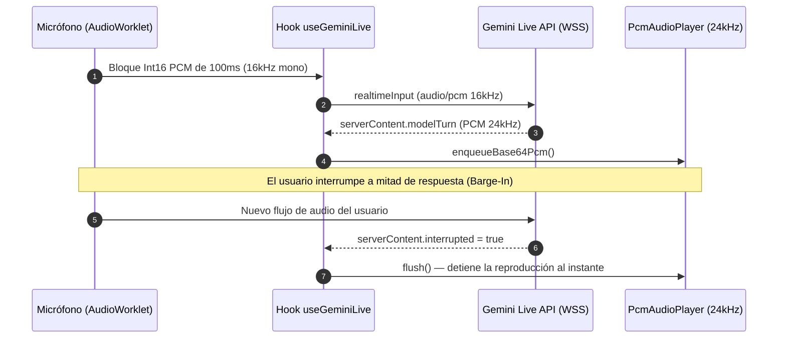

<p align="right">
  <a href="./README.md">🇺🇸 Read in English</a>
</p>

<p align="center">
  
</p>

<p align="center">
  
  
  
  
</p>

# Gemini Live Voice Starter

Plantilla modular en React + TypeScript para construir **agentes de IA de voz bidireccionales y de baja latencia** con la **Gemini Live API** (`@google/genai`). Resuelve desde el primer minuto los cuellos de botella más complejos del audio en el navegador: captura PCM a 16kHz fuera del hilo principal, reproducción continua a 24kHz y manejo instantáneo de interrupciones (**barge-in**) dentro de una interfaz móvil adaptada a `100dvh`.

---

## Por qué importa el audio nativo de extremo a extremo

Los asistentes de voz tradicionales encadenan tres modelos distintos (`STT → LLM → TTS`), lo que suma latencia perceptible y turnos rígidos. La Gemini Live API procesa audio crudo de forma nativa sobre una conexión WebSocket con estado (`BidiGenerateContent`), recibiendo PCM a 16kHz y devolviendo PCM a 24kHz con detección automática de actividad de voz (VAD) e interrupciones en tiempo real.

<p align="center">
  
</p>

---

## Arquitectura y flujo de interrupción (Barge-In)



---

## Características principales

- **Captura `AudioWorklet` fuera del hilo principal (`src/audio/pcm-worklet.ts`)**: Captura audio a `16,000 Hz`, convierte muestras `Float32` a `Int16` PCM little-endian en bloques de 100ms (`1,600` muestras) y calcula la amplitud RMS en tiempo real para animar la interfaz.
- **Reproductor 24kHz sin cortes + Barge-In (`src/audio/pcm-player.ts`)**: Programa bloques PCM mono a `24,000 Hz` de forma continua y limpia todos los nodos `AudioBufferSourceNode` activos en el milisegundo en que llega `serverContent.interrupted`.
- **Selector de modelos (`src/live/useGeminiLive.ts`)**: Listo para alternar entre `gemini-3.8-live` (turnos inmediatos) y `gemini-3.8-live-extended-thinking` (razonamiento en segundo plano y herramientas asíncronas con conectores conversacionales).
- **Consola móvil `100dvh` (`src/components/VoiceConsole.tsx`)**: Interfaz responsiva de pantalla completa con transcripciones en vivo de entrada y salida.

---

## Inicio rápido

```bash
git clone https://github.com/stephanocamoretti-dotcom/gemini-live-voice-starter.git
cd gemini-live-voice-starter
npm install
cp .env.example .env
# Agrega tu API key de Gemini en .env
npm run dev
```

---

## Ideas de escalado para producción

1. **Tokens Efímeros (Seguridad)**: Nunca expongas tu API key real en el navegador en producción. Genera *Ephemeral Tokens* de corta duración desde tu backend (Cloudflare Workers / FastAPI / Node) antes de abrir el WebSocket cliente-servidor.
2. **Tool Calling asíncrono e integración CRM**: Combina `gemini-3.8-live-extended-thinking` con declaraciones de funciones para consultar stock, agendar citas o disparar flujos en n8n/WhatsApp mientras el modelo mantiene la conversación natural.
3. **Puente WebRTC / Telefonía SIP**: Conecta el stream PCM de `24kHz` a LiveKit Agents o un gateway WebRTC para atender llamadas telefónicas entrantes con el mismo agente.
4. **Diálogo afectivo y audio proactivo**: Activa `affectiveDialog` y umbrales personalizados de VAD para que el agente adapte su tono a la urgencia del cliente y sepa cuándo guardar silencio.

---

## Referencias

- [Resumen de Gemini Live API — Google AI for Developers](https://ai.google.dev/gemini-api/docs/live)
- [Guía de capacidades de Live API (PCM 16kHz/24kHz, VAD, Ephemeral Tokens)](https://aistudio.google.com/docs/live-api/capabilities)
- [Razonamiento en Live API (`gemini-3.8-live-extended-thinking`)](https://aistudio.google.com/docs/live-api/thinking)
- [Mejores prácticas de Live API — Google AI for Developers](https://ai.google.dev/gemini-api/docs/live-api/best-practices)
- [Referencia WebSockets de Live API (`BidiGenerateContent`)](https://ai.google.dev/api/live)
