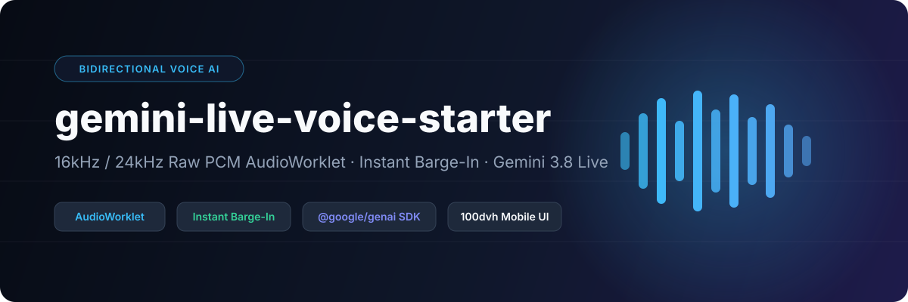
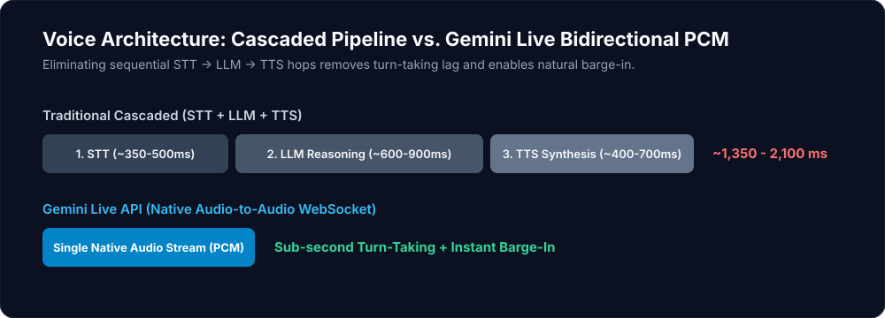
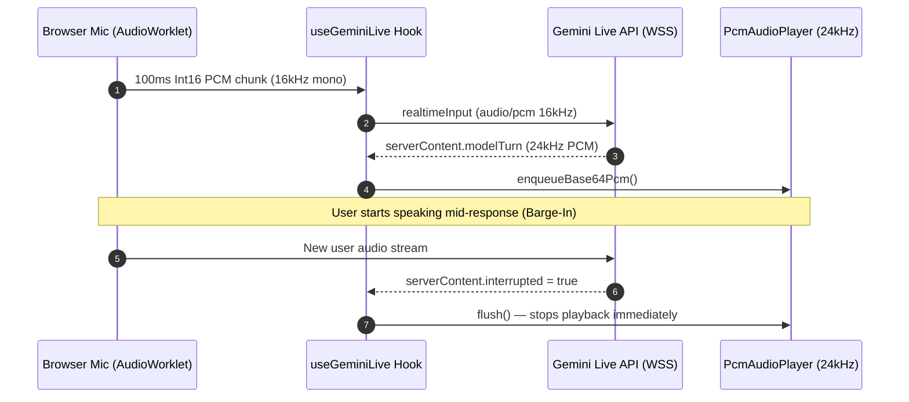

<p align="right">
  <a href="./README.es.md">🇪🇸 Leer en Español</a>
</p>

<p align="center">
  
</p>

<p align="center">
  
  
  
  
</p>

# Gemini Live Voice Starter

A clean, production-inspired React + TypeScript starter for building **ultra-low-latency bidirectional Voice AI agents** with the **Gemini Live API** (`@google/genai`). It solves the hardest browser audio engineering bottlenecks out of the box: off-main-thread 16kHz PCM capture, gapless 24kHz PCM playback, and instant **barge-in** interruption handling inside a mobile-ready `100dvh` layout.

---

## Why Native Audio-to-Audio Matters

Traditional voice assistants chain three separate models (`STT → LLM → TTS`), introducing noticeable conversational lag and awkward turn-taking. The Gemini Live API processes raw audio natively over a stateful `BidiGenerateContent` WebSocket, streaming 16kHz PCM in and 24kHz PCM out with built-in Voice Activity Detection (VAD) and barge-in.

<p align="center">
  
</p>

---

## Architecture & Barge-In Flow



---

## Key Features

- **Off-Thread `AudioWorklet` Capture (`src/audio/pcm-worklet.ts`)**: Captures microphone audio at `16,000 Hz`, converts `Float32` samples to little-endian `Int16` PCM in 100ms chunks (`1,600` samples), and computes real-time RMS amplitude for reactive UI orbs.
- **Gapless 24kHz Player + Instant Barge-In (`src/audio/pcm-player.ts`)**: Schedules `24,000 Hz` mono PCM chunks seamlessly and flushes all active `AudioBufferSourceNode` instances the millisecond `serverContent.interrupted` fires.
- **Model Switching (`src/live/useGeminiLive.ts`)**: Ready for both `gemini-3.8-live` (immediate turn-taking) and `gemini-3.8-live-extended-thinking` (background reasoning & async tool execution with conversational fillers).
- **Mobile-First `100dvh` Console (`src/components/VoiceConsole.tsx`)**: Responsive full-viewport layout with live input/output audio transcriptions.

---

## Quick Start

```bash
git clone https://github.com/stephanocamoretti-dotcom/gemini-live-voice-starter.git
cd gemini-live-voice-starter
npm install
cp .env.example .env
# Add your Gemini API key to .env
npm run dev
```

---

## Scaling Ideas for Production

1. **Ephemeral Tokens (Security)**: Never ship a raw API key to production browsers. Mint short-lived Ephemeral Tokens from your backend (Cloudflare Workers / FastAPI / Node) before opening client-to-server WebSockets.
2. **Async Tool Calling & CRM Sync**: Pair `gemini-3.8-live-extended-thinking` with function declarations to query inventory, book calendar slots, or trigger n8n/WhatsApp workflows while the model speaks natural fillers.
3. **WebRTC / SIP Telephony Bridge**: Pipe the `24kHz` PCM stream into LiveKit Agents or a WebRTC gateway to deploy the exact same voice agent over inbound phone calls.
4. **Affective Dialog & Proactive Audio**: Enable `affectiveDialog` and custom VAD thresholds so the agent adapts tone to caller urgency and knows when to stay silent.

---

## References

- [Gemini Live API Overview — Google AI for Developers](https://ai.google.dev/gemini-api/docs/live)
- [Live API Capabilities Guide (16kHz/24kHz PCM, VAD, Ephemeral Tokens)](https://aistudio.google.com/docs/live-api/capabilities)
- [Thinking in the Live API (`gemini-3.8-live-extended-thinking`)](https://aistudio.google.com/docs/live-api/thinking)
- [Live API Best Practices — Google AI for Developers](https://ai.google.dev/gemini-api/docs/live-api/best-practices)
- [Live API WebSockets Reference (`BidiGenerateContent`)](https://ai.google.dev/api/live)
